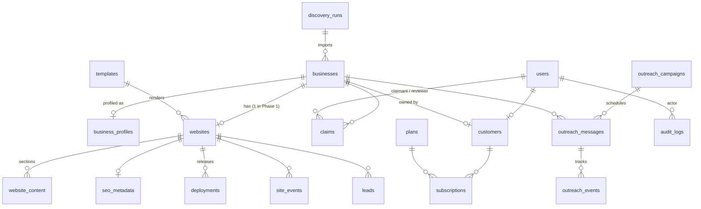

# Database Design

PostgreSQL 16 is the system of record (doc 15), with `pgvector`, `pg_trgm` and `pgcrypto` installed by
`infrastructure/postgres/init.sql`. Redis holds rate-limit counters (and later, caches). Object storage holds
published sites. **Source of truth:** `backend/app/models/`. **Migrations:** `backend/migrations/`.
**Rendered DDL:** [`database/schema/schema.sql`](../database/schema/schema.sql).

## Conventions

* `id UUID` primary keys (app-generated `uuid4`). `plans` uses its natural key `code`.
* `created_at` / `updated_at` as `TIMESTAMPTZ DEFAULT now()`.
* Enums are `VARCHAR(32)` with a named `CHECK` constraint (`ck_<table>_<enum>`). Adding a value is a plain migration.
* Flexible documents (blueprints, content, theme, schema.org markup, risk factors) are `JSONB`.
* Deterministic constraint names: `pk_`, `fk_<table>_<col>_<ref>`, `uq_`, `ix_`, `ck_`.
* Deletes: business-owned data cascades (`ON DELETE CASCADE`). Actor references use `SET NULL` so audit
  history survives user deletion. Businesses are archived (soft delete) in normal operation.
* No raw IP addresses are stored for analytics or leads, only salted hashes (`site_events.visitor_hash`,
  `leads.ip_hash`). Claims store the IP for abuse investigation.

## Entity relationships



## Tables

| Context | Table | Purpose | Notable constraints / indexes |
|---|---|---|---|
| Identity | `users` | Staff and customer identities, RBAC role, OAuth/MFA-ready columns | `uq email`, `uq (oauth_provider, oauth_subject)`, `ix role` |
| Discovery | `businesses` | Normalized directory record plus opportunity score | `uq slug`, `uq dedupe_key`, `ck score 0..100`, `ix (generate_candidate, score)`, `ix (industry, city)`, `ix status` |
| Discovery | `discovery_runs` | One import/crawl batch with created/duplicate/error counters | |
| Intelligence | `business_profiles` | Industry, category, services, keywords, tone, recommended template | `uq business_id`, `ix category` |
| Templates | `templates` | Master template: pages → sections, theme tokens, industries | `uq slug`, `ix category` |
| Templates | `template_components` | Component library registry | `uq slug`, `uq (component_type, variant)` |
| Factory | `websites` | Blueprint, quality report, subdomain, status, build version | `uq business_id`, `uq subdomain`, `ix status` |
| Factory | `website_content` | **Content cache**: one JSON block per section plus its source (template/ai/customer/operator) | `uq (website_id, section_key)` |
| Factory | `media_assets` | Image library (generated, shared) and customer uploads; **P2:** `sha256`, `size_bytes`, `width/height`, `usage_count` | `ix industry`, `ix business_id`, `ix sha256` |
| SEO | `seo_metadata` | Title, description, keywords, local keywords, schema.org, score; **P2:** per-page `pages` meta and the latest `audit` | `uq website_id` |
| Publishing | `deployments` | Each publish: version, storage backend, artifact path, size, error | `ix website_id` |
| Claims | `claims` | Claimant, method, hashed token/OTP, attempts, risk, review | **`uq_claims_business_approved` partial unique `(business_id) WHERE status='approved'`**, `uq verification_token_hash`, `ix (business_id, status)` |
| Customers | `customers` | Verified owner ↔ business, current plan | `uq user_id`, `uq business_id` |
| Customers | `leads` | Contact-form submissions | `ix website_id`, `ix created_at` |
| Billing | `plans` | Product ladder and feature entitlements (prices editable without deploy) | PK `code` |
| Billing | `subscriptions` | Plan history per customer, provider reference | **partial unique `(customer_id) WHERE status='active'`** |
| Outreach | `outreach_campaigns` | Sequence definition and target filter | |
| Outreach | `outreach_messages` | Rendered message per business per step, tracking token | `uq (campaign_id, business_id, step)`, `uq tracking_token`, `ix (status, scheduled_at)` |
| Outreach | `outreach_events` | sent / opened / clicked / visited / claim_started / claim_completed / unsubscribed | `ix (business_id, event_type)`, `ix occurred_at` |
| Outreach | `outreach_suppressions` | Do-not-contact list | `uq email` |
| Analytics | `site_events` | Cookieless page views and interactions | `ix (website_id, event_type, occurred_at)` |
| Audit | `audit_logs` | Who did what, when, from where | `ix action`, `ix (entity_type, entity_id)`, `ix created_at` |
| Platform | `domain_events` | Transactional outbox (relayed to the Redis stream `gumaweb:events` by workers) | `ix event_type`, `ix processed_at` |
| Factory (P2) | `factory_jobs` | Durable work queue: kind, payload, status, attempts/backoff, lock owner, result | `ix (status, run_after, priority)`, **partial unique `(dedupe_key) WHERE status IN ('queued','running')`** |
| CRM (P3) | `contacts` | One person per business: name, email, phone, source, stage, deal value, tags | **partial unique `(business_id, email)` and `(business_id, phone)`**, `ix (business_id, stage)` |
| CRM (P3) | `contact_activities` | Timeline: form submission, booking, chat, stage change, note/call/email/meeting | `ix contact_id` |
| Booking (P3) | `booking_settings` | Per-business hours (JSON), services, slot step, buffer, notice, window, auto-confirm | PK `business_id` |
| Booking (P3) | `appointments` | Service, start/end (UTC), status, visitor details, hashed manage token | `ix (business_id, starts_at)`, **partial unique `(business_id, starts_at) WHERE status IN ('pending','confirmed')`** |
| Chatbot (P3) | `chatbot_settings` | Enabled, greeting, hand-off message, lead collection | PK `business_id` |
| Chatbot (P3) | `knowledge_entries` | Website-derived and owner-written Q&A | `ix business_id` |
| Chatbot (P3) | `chat_conversations` / `chat_messages` | Sessions (hashed token, lead flag) and messages (strategy, sources, tokens, latency) | `uq session_token_hash`, `ix conversation_id` |
| CRM (P4) | `contacts` (+) | `lead_score`, `lead_temperature`, `score_reasons` (explainable lead intelligence) | `ix lead_score` |
| Automation (P4) | `automation_rules` | Trigger, config, conditions, actions (JSON), enabled, preset key | `ix (business_id, trigger)` |
| Automation (P4) | `automation_runs` | One row per rule × trigger × subject: status, per-action results | **`uq idempotency_key`** (exactly-once side effects) |
| Voice (P4) | `voice_settings` | Receptionist on/off, phone number, forward number | PK `business_id`, **`uq phone_number`** |
| Voice (P4) | `calls` | Caller, state, transcript, outcome, summary, linked contact/appointment, duration | `ix (business_id, started_at)` |
| Integrations (P4) | `api_keys` | Name, prefix, SHA-256 hash, read-only, last used, revoked | **`uq key_hash`** |
| Integrations (P4) | `webhook_endpoints` | URL, events, secret version (secret derived, not stored), active, failure streak | `ix business_id` |
| Integrations (P4) | `webhook_deliveries` | Event, payload, status, attempts, response status, last error | `ix endpoint_id`, `ix created_at` |
| Presence (P5) | `presence_kits` | Brand, social kit, Google pack, SEO profile (JSON), rendered image keys per version, checklist | **`uq business_id`** |
| Presence (P5) | `custom_domains` | Domain (punycode), status, verification token, serve-website flag, last check | **`uq domain`**, `ix business_id` |
| Presence (P5) | `mail_domains` | Mail server domain ref, cached DNS records, status, missing records | **`uq domain_id`** |
| Presence (P5) | `mailboxes` | Local part, kind (mailbox/forward), forward targets, quota, mail server ref (no passwords) | **`uq (mail_domain_id, local_part)`** |
| Factory (P2) | `ai_generations` | Every model call: content cache + token/latency/acceptance ledger | `uq cache_key`, `ix task`, `ix created_at` |

The doc 15 sketches (`businesses`, `websites`, `claims`, `customers`, `outreach_events`) are all present
and extended. Every column from those sketches exists under the same name.

## Invariants enforced by the database

1. A business is unique by its canonical *name + city + phone* (`dedupe_key`).
2. One website per business, and globally unique subdomains.
3. **At most one approved owner per business** (partial unique index on claims).
4. One active subscription per customer.
5. One content block per section per website, and each campaign messages a business once per step.
6. At most one queued or running factory job per dedupe key (e.g. one generation per business).
7. One CRM contact per email and per phone within a business.
8. No two active appointments start at the same time for a business.

## Redis usage

| Key | Purpose | TTL |
|---|---|---|
| `ratelimit:<scope>:<identity>` | Fixed-window counters (login, claims, contact, beacon) | window length |
| *(Phase 2)* `profile:<business_id>`, `content:<website_id>:<section>`, `seo:<website_id>` | Caches from doc 15 | hours |

## Migration workflow

```bash
cd backend
# 1. change models in app/models/
alembic revision --autogenerate -m "add xyz"    # against a database at head
# 2. review the generated file (types, server defaults, data migrations)
alembic upgrade head
alembic check                                    # must print "No new upgrade operations detected"
../scripts/generate-schema-sql.sh                # refresh database/schema/schema.sql
```

Migrations run automatically in compose (`migrate` service) and on Kubernetes (Helm hook Job
`post-install, pre-upgrade`). Write migrations to be backward compatible (expand, then contract) so the
previous API version keeps working during a rolling update.

## Planned (Phase 2)

* `embeddings (id, owner_type, owner_id, model, vector VECTOR(1024))` with an HNSW index, for BGE-M3 semantic
  search, duplicate detection and industry patterns.
* Partition `site_events` and `outreach_events` by month once volume grows (around 10⁷ rows).
* A read replica for analytics queries (CloudNativePG).
